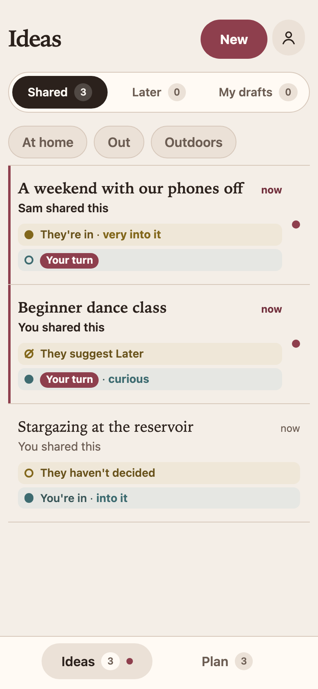
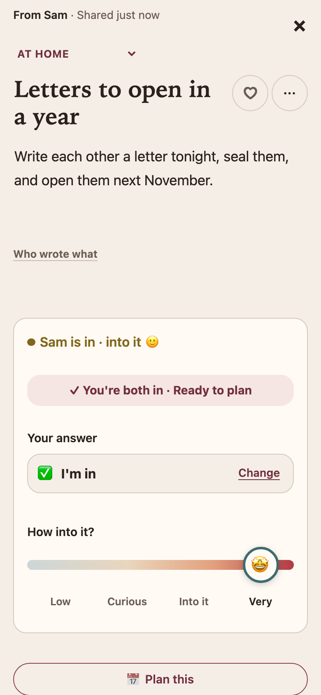
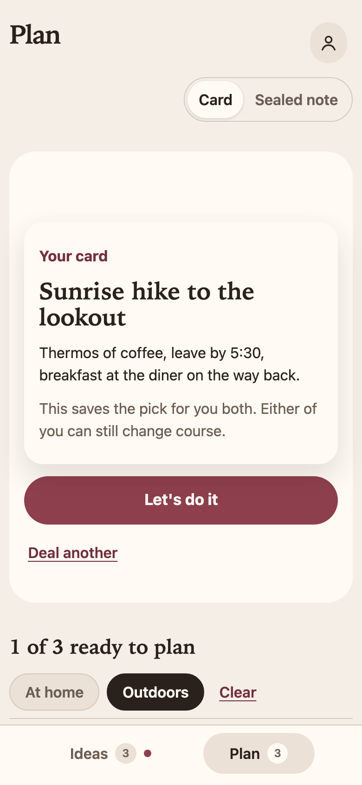
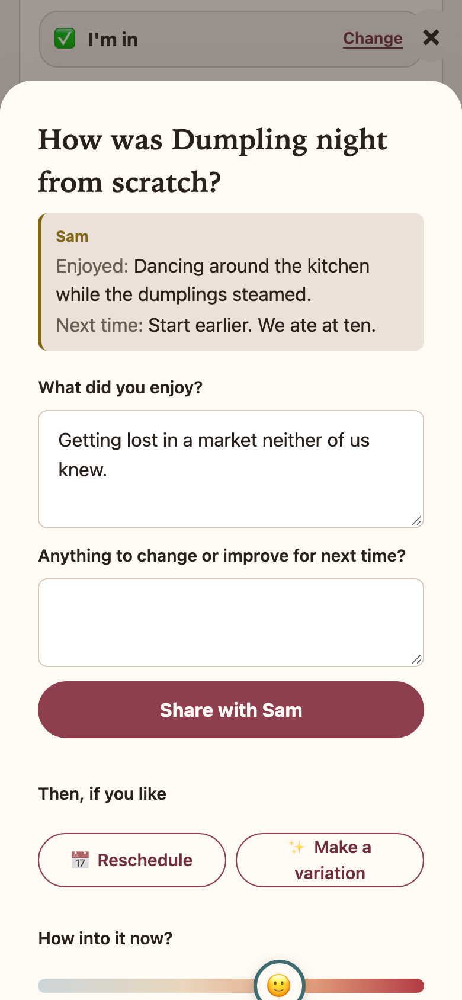

# Ours

**Plan time together, for two.**

Relationships grow in shared time, and most of it never gets planned. The good ideas end up scattered
across texts and "we should do that sometime". Ours gives two people one place to collect those ideas,
choose the ones they both want, and turn them into dates.

<p>
  
  
  
  
</p>

## What's different

- **Made for two.** Each of you adds ideas and answers the other's. Plan only holds what you both
  chose.
- **A little surprise.** Instead of debating what to do, deal a card from your shared list, pick a
  night, and it's on both phones.
- **Dates build on each other.** Afterwards, each of you shares a favorite moment and one thing for next
  time. Good dates become new ideas.
- **Private.** Each couple's space is walled off in the database, and email only says something's
  waiting.

## How it was built

One person directing two AI coding agents, Codex and Claude, taking turns on one codebase. They worked
under a written [working agreement](AGENTS.md), tests first, with a shared
[plan and handoff log](docs/plans/2026-10-23-personal-alpha-mvp-implementation.md) either agent could
pick up from. It went from first commit to real use in a week.

- React 19, TypeScript, Vite; Supabase (Postgres row-level security, pg_cron + Edge Function email).
- 281 unit and component tests, 1,108 database assertions on access and isolation, and 7 end-to-end
  specs against the real local stack.

## Run it locally

Needs Node 22.13+ and Docker.

```bash
npm install
npx supabase start
npx supabase db reset && npm run dev:accounts
npm run dev
```

Sign in as `partner-a@example.com` and `partner-b@example.com` (password `ours-local-synthetic`) in two
browsers. Tests: `npm test`, `npx supabase test db`, `npm run test:e2e`.
