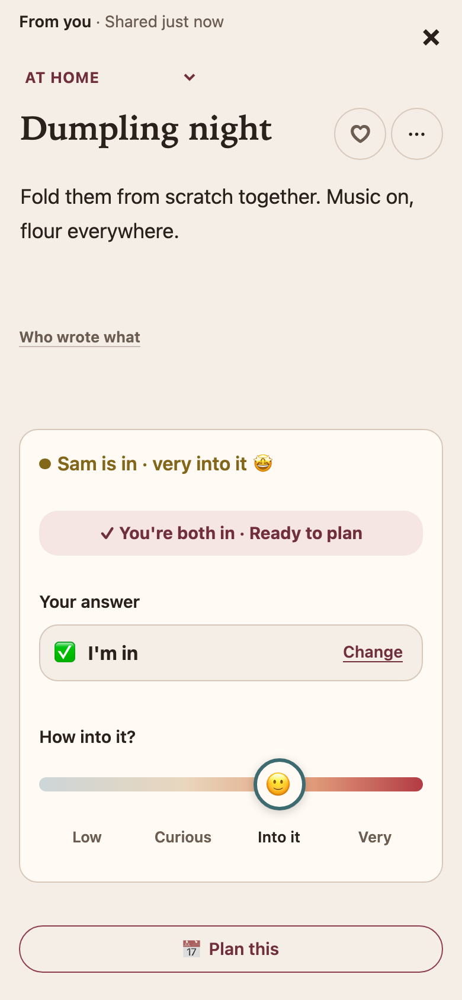
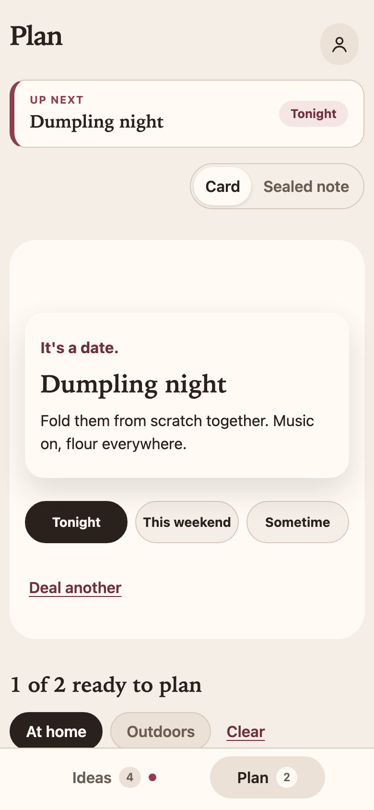
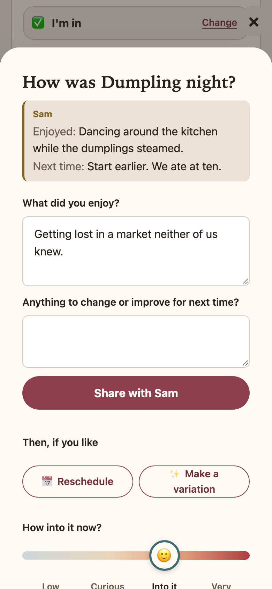

# Ours

**Strengthening relationships through candid conversation and shared time.**

What if technology enhanced our most valued connections, instead of distracting from them?

I built a PWA for couples to make and discuss plans together. Share ideas, see where interest is
mutual, align, and make it happen. Afterwards, reflect on the experience and create variations.

<p>
  
  
  
</p>

## What's different

- **A little surprise.** Instead of debating what to do, deal a card from the ideas you both chose.
  Pick a night, and it's on both phones.
- **Private.** Each couple's space is walled off in the database, and email only says something's
  waiting.

## How it was built

I directed two AI coding agents, Codex and Claude, taking turns on one codebase. They worked
under a written [working agreement](AGENTS.md): tests first, and a shared plan and handoff log either
agent could pick up from. It went from first commit to real use in a week.

- React 19, TypeScript, Vite; Supabase (Postgres row-level security, pg_cron + Edge Function email).
- 281 unit and component tests, 1,108 database assertions on access and isolation, and 7 end-to-end
  specs against the real local stack.

## Run it locally

Needs Node 22.13+ and Docker.

```bash
npm install
npx supabase start
npx supabase db reset && npm run dev:accounts
npm run dev
```

Sign in as `partner-a@example.com` and `partner-b@example.com` (password `ours-local-synthetic`) in two
browsers. Tests: `npm test`, `npx supabase test db`, `npm run test:e2e`.
